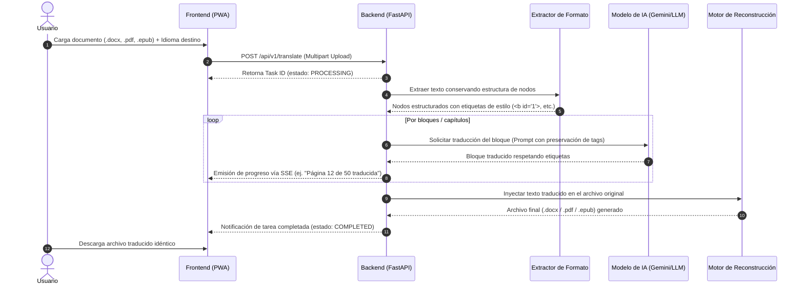
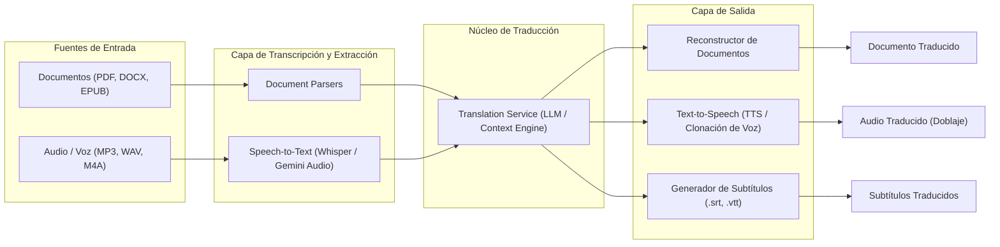

# Arquitectura y Especificaciones Técnicas
## Proyecto: Traductor Inteligente de Documentos (PWA)

---

## 1. Resumen Ejecutivo y Objetivos

El objetivo de este proyecto es construir una **Aplicación Web Progresiva (PWA)** respaldada por un **Backend en Python** que permita a los usuarios cargar libros y documentos en distintos formatos (PDF, DOCX, EPUB, TXT), traducirlos a múltiples idiomas con alta precisión semántica y estilística, y devolver el archivo traducido **preservando íntegramente la maquetación, formato y estilo visual original**.

El sistema se diseña con una **arquitectura desacoplada y orientada a servicios (Clean Architecture / Puertos y Adaptadores)**, de modo que en fases posteriores pueda incorporar sin fricciones nuevas fuentes de entrada, como **traducción de audios (Speech-to-Text / Voice Cloning)** o subtitulado de vídeos.

---

## 2. Pila Tecnológica (Tech Stack)

### 2.1 Backend (Procesamiento y Servicios)
* **Lenguaje:** **Python 3.11+** (Excelente ecosistema para IA, procesamiento de texto y manipulación de archivos).
* **Framework Web:** **FastAPI**
  * *Justificación:* Extremadamente rápido, soporte nativo de asincronía (`async/await`), tipado estricto con Pydantic y documentación interactiva automática en `/docs` (Swagger UI), ideal para probar endpoints sin depender inmediatamente del frontend.
* **Procesamiento de Documentos:**
  * **DOCX:** `python-docx` (manipulación de párrafos, tablas, estilos OpenXML).
  * **EPUB:** `ebooklib` + `BeautifulSoup4` (edición de capítulos XHTML conservando CSS y estructura de libro digital).
  * **PDF:** `PyMuPDF` (`fitz`) para lectura/extracción de bloques y `pdf2docx` / `WeasyPrint` para reconstrucción de diseño.
* **Control de Tareas en Segundo Plano:** Tareas asíncronas (`FastAPI BackgroundTasks` o `Celery` + `Redis` para escalado futuro) con actualizaciones en tiempo real mediante **Server-Sent Events (SSE)** o **WebSockets**.

### 2.2 Frontend (Aplicación Web Progresiva - PWA)
* **Tecnología:** HTML5, CSS3 moderno (o Tailwind CSS) y JavaScript moderno (ES Modules) o entorno ligero con **Vite**.
* **Capacidades PWA:**
  * `manifest.json`: Permite instalar la aplicación en el escritorio (Windows/Mac) o dispositivos móviles (Android/iOS) como si fuera una app nativa.
  * `service-worker.js`: Caché de recursos estáticos, experiencia fluida e interacción sin interrupciones.
  * Experiencia de usuario (UX): Arrastrar y soltar archivos (*drag & drop*), previsualización de documento, selector de tono/estilo y barra de progreso de traducción en vivo por página/capítulo.

---

## 3. Estrategia y Selección de Modelos de IA

Para garantizar traducciones de alta calidad y rentabilidad, el sistema implementa el **Patrón Estrategia (Strategy Pattern)**, permitiendo intercambiar o combinar modelos según la necesidad:

```
                  ┌────────────────────────────────────────┐
                  │       TranslationService (Interfaz)     │
                  └───────────────────┬────────────────────┘
                                      │
          ┌───────────────────────────┼───────────────────────────┐
          ▼                           ▼                           ▼
┌───────────────────┐       ┌───────────────────┐       ┌───────────────────┐
│  Gemini Provider  │       │  DeepL Provider   │       │  OpenAI Provider  │
│ (Ventana de 1M-2M │       │ (Precisión NMT    │       │ (GPT-4o / mini    │
│  tokens, libros)  │       │  para terminología)│      │  alto razonamiento)│
└───────────────────┘       └───────────────────┘       └───────────────────┘
```

### 3.1 Proveedores Principales
1. **Google Gemini (Gemini 1.5/2.5 Flash & Pro):**
   * **Ventaja clave para libros:** Posee una ventana de contexto de más de **1 millón de tokens**. Esto permite pasarle glosarios gigantescos, capítulos enteros o el libro completo en un solo contexto, garantizando que el tono y los nombres de personajes o términos técnicos sean **100% coherentes** de principio a fin.
   * Relación costo/rendimiento inmejorable para grandes volúmenes de texto.
2. **DeepL API (Opcional/Alternativo):**
   * Motor de NMT altamente pulido para documentos corporativos y técnicos.
3. **OpenAI (GPT-4o / GPT-4o-mini):**
   * Gran capacidad de seguimiento estricto de directivas de formato (XML/JSON tags) y preservación de etiquetas en línea.

---

## 4. Pipeline de Procesamiento de Documentos

El flujo de trabajo para procesar y traducir un documento sin perder formato sigue 5 pasos deterministas:



### Detalle de las Etapas:
1. **Extracción y Enmascarado (*Masking*):**
   * El texto con formatos en línea (negritas, cursivas, enlaces, colores) se envuelve en etiquetas semánticas (`<bold id="x">texto</bold>`).
2. **Traducción con Restricciones Estructurales:**
   * El prompt al modelo de IA exige explícitamente: *"Traduce únicamente el texto interior, preserva estrictamente los atributos y etiquetas `<bold id="x">` sin alterarlas ni moverlas de posición"*.
3. **Ajuste Tipográfico (*Text Expansion*):**
   * Al traducir de inglés a español, el texto suele crecer un 15-25%. El motor recalcula espaciados y, en PDFs, aplica escala proporcional de fuente (*font scaling*) para prevenir desbordamientos.
4. **Reconstrucción:**
   * El archivo de salida se genera clonando el archivo fuente original y reemplazando únicamente los valores textuales de los nodos.

---

## 5. Diseño Preparado para el Futuro: Extensión a Audio y Multimedia

Para cumplir con el requerimiento de soportar traducciones de audio en el futuro, la arquitectura contempla una capa de **Ingestión Multimodal**:



* **Fase Futura de Audio:**
  1. **Entrada de audio:** Recepción de notas de voz o archivos de audio.
  2. **Speech-to-Text (STT):** Uso de modelos como **OpenAI Whisper** o **Gemini Audio API** con marcas de tiempo (*timestamps*).
  3. **Traducción:** Ajuste cultural y sincronización de tiempos.
  4. **Text-to-Speech (TTS):** Generación de voz natural en el idioma destino (ej. con **Edge-TTS** gratuito o **ElevenLabs**).

---

## 6. Estructura de Directorios del Proyecto

La estructura de carpetas está organizada según principios de modularidad y responsabilidad única:

```text
TRADUCTOR DE DOCUMENTOS/
│
├── docs/                                # Documentación de diseño y guías
│   └── ARQUITECTURA_Y_ESPECIFICACIONES.md
│
├── backend/                             # Servidor y lógica en Python
│   ├── app/
│   │   ├── api/                         # Rutas y controladores HTTP
│   │   │   ├── v1/
│   │   │   │   ├── endpoints/
│   │   │   │   │   ├── translation.py   # Subida de archivos y consulta de estado
│   │   │   │   │   └── health.py        # Comprobación de estado del sistema
│   │   │   │   └── router.py
│   │   │
│   │   ├── core/                        # Configuraciones globales y variables de entorno
│   │   │   └── config.py
│   │   │
│   │   ├── services/                    # Lógica de negocio principal
│   │   │   ├── parsers/                 # Extracción y reconstrucción de archivos
│   │   │   │   ├── base.py              # Clase base abstracta de parser
│   │   │   │   ├── docx_parser.py       # Manejador de Word (.docx)
│   │   │   │   ├── epub_parser.py       # Manejador de libros (.epub)
│   │   │   │   └── pdf_parser.py        # Manejador de PDFs (.pdf)
│   │   │   │
│   │   │   ├── translators/             # Proveedores de traducción (IA)
│   │   │   │   ├── base.py              # Interfaz común de traducción
│   │   │   │   ├── gemini_translator.py # Integración con Google Gemini
│   │   │   │   └── mock_translator.py   # Traductor simulado para pruebas locales
│   │   │   │
│   │   │   └── audio/                   # [Preparado para futuro] Módulo de audio
│   │   │       └── whisper_service.py
│   │   │
│   │   ├── models/                      # Esquemas de datos Pydantic
│   │   │   └── translation_job.py
│   │   │
│   │   └── main.py                      # Punto de entrada de la aplicación FastAPI
│   │
│   ├── requirements.txt                 # Dependencias de Python
│   └── .env.example                     # Plantilla de variables de entorno (claves API)
│
├── frontend/                            # Cliente Web Progresivo (PWA)
│   ├── index.html                       # Interfaz principal de usuario
│   ├── manifest.json                    # Manifiesto de instalación PWA
│   ├── sw.js                            # Service Worker para capacidades PWA
│   ├── css/
│   │   └── styles.css                   # Estilos modernos y responsivos
│   └── js/
│       ├── app.js                       # Lógica de interacción y drag & drop
│       ├── api.js                       # Comunicación con la API de FastAPI
│       └── sse.js                       # Escucha de progreso en tiempo real
│
├── storage/                             # Directorio local temporal para subidas/descargas
│   ├── uploads/
│   └── processed/
│
├── README.md                            # Guía de inicio rápido
└── .gitignore                           # Exclusión de archivos temporales y entornos
```

---

## 7. Metodología de Desarrollo y Hoja de Ruta (Roadmap)

Se adoptará un enfoque iterativo e incremental (**Metodología Ágil / MVP - Producto Mínimo Viable**), garantizando que en cada fase se obtenga software funcional:

### **Fase 1: Cimientos y Entorno de Trabajo (Paso Inmediato)**
1. Inicializar el entorno virtual de Python (`venv`) con Python 3.11.
2. Instalar dependencias esenciales (`fastapi`, `uvicorn`, `python-docx`, `google-genai`).
3. Crear el esqueleto de directorios y el servidor FastAPI mínimo con un endpoint de prueba (`GET /api/v1/health`).
4. Configurar el archivo `.env` para almacenar la clave de API (ej. Gemini API Key).

### **Fase 2: Motor de Documentos (DOCX & EPUB) y Traductor Base**
1. Implementar la interfaz abstracta `BaseParser` y `BaseTranslator`.
2. Crear el parser de archivos Word (`.docx`) identificando y reemplazando texto sin alterar estilos ni tablas.
3. Conectar el servicio de traducción con Gemini para traducir párrafos por lotes.
4. Crear el parser para libros `.epub`.

### **Fase 3: Parser Avanzado para PDF**
1. Implementar estrategia híbrida para PDFs (extracción mediante `PyMuPDF` o flujo `PDF -> DOCX -> Traducir -> PDF`).
2. Ajustar control de desbordamiento de fuentes tipográficas (*font-scaling*).

### **Fase 4: Frontend PWA Moderno**
1. Crear la interfaz web con soporte para arrastrar documentos, selector de idioma (inglés, español, francés, alemán, etc.) y selector de tono (académico, literario, informal).
2. Configurar el `manifest.json` y `sw.js` para que la web sea instalable como aplicación nativa en Windows y móviles.
3. Integrar eventos de progreso para ver en tiempo real cómo avanza la traducción del documento.

### **Fase 5: Extensión Multimodal (Audio)**
1. Agregar soporte para recibir audios (`.mp3`, `.wav`, `.m4a`).
2. Integrar transcripción automática con marcas de tiempo (Whisper).
3. Exportar audio doblado o subtítulos traducidos (`.srt`).

---

## 8. Consideraciones de Seguridad y Buenas Prácticas
* **Privacidad de Documentos:** Los archivos almacenados temporalmente en `storage/` contarán con un mecanismo de limpieza automática tras un periodo de inactividad (ej. 2 horas).
* **Gestión de Claves:** Las API Keys nunca se exponen al cliente frontend; se consumen exclusivamente desde el backend en variables de entorno seguras (`.env`).
* **Manejo de Errores Resiliente:** Si una llamada a la API de IA falla temporalmente por límite de cuota (*rate limit*), el sistema implementa reintentos exponenciales automáticos (*exponential backoff*).
